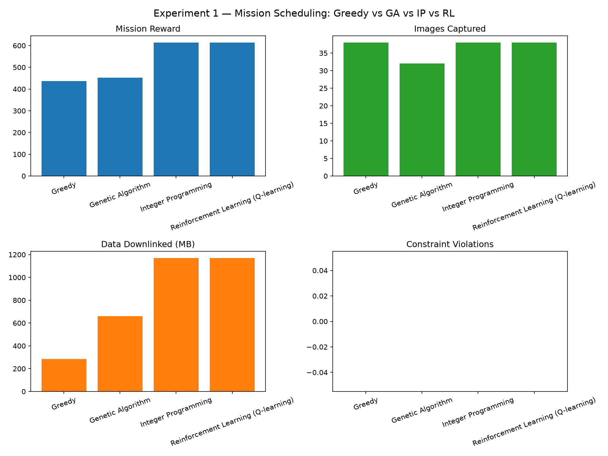
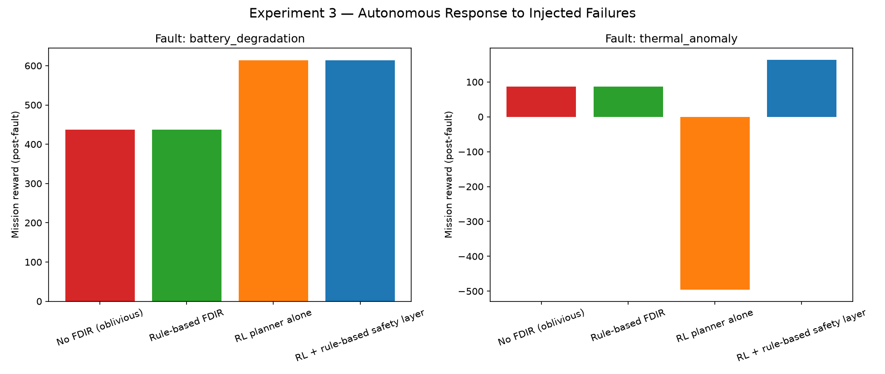
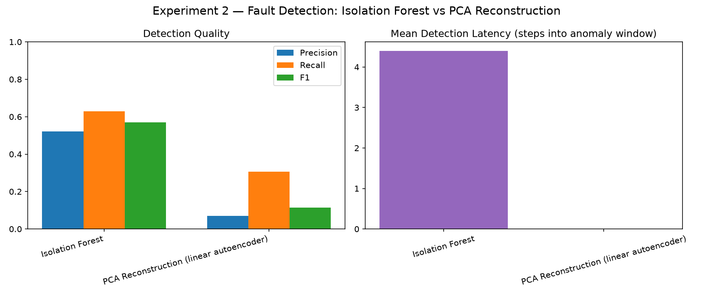
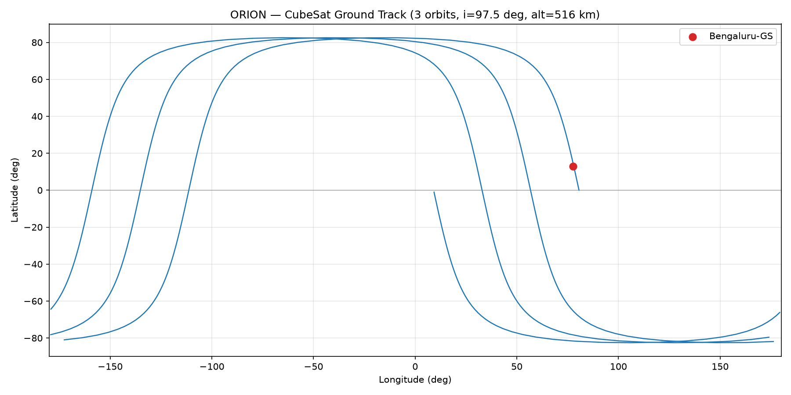

# ORION — Autonomous AI Mission Planning & Digital Twin Platform for Small Satellites

A complete software digital twin of a CubeSat mission: real orbital
mechanics, a resource-constrained spacecraft twin, three classical
mission planners plus a reinforcement-learning planner, telemetry
generation with injected/labeled anomalies, two anomaly detectors, an
end-to-end simulator, three research experiments with generated
figures, and a live mission-control dashboard.

The aerospace content (orbital mechanics, spacecraft constraints) is
load-bearing: the AI layer makes decisions *under physical constraints*
derived from orbit propagation, and every planner is benchmarked against
the same physics, so the comparisons measure planner quality rather than
differences in the simulation.

## Key results

| Experiment | Result |
|---|---|
| 1. Scheduling (8-orbit scenario) | Integer Programming and Q-learning both reach the optimal reward of **614**, vs 452 (GA) and 437 (Greedy); they downlink **1170 MB vs 285 MB**. IP plans in ~0.1 s, Q-learning in ~2 s |
| 2. Fault detection (121 labelled anomalous steps) | Isolation Forest **F1 0.57** (P 0.52, R 0.63) vs **0.11** for PCA reconstruction |
| 3. Autonomous response (thermal fault) | RL alone, never trained on the fault, drops to **−496 reward / 62 violations**, worse than no response (87 / 14). A rule-based safety layer on top recovers **164 reward / 18 violations** |

<p align="center">
  
  
</p>
<p align="center">
  
  
</p>

## Status — all 7 layers implemented

| Layer | Module | What it does |
|---|---|---|
| 1. Orbital mechanics | `orbital/` | Keplerian + SGP4/TLE propagation, ECI/ECEF/geodetic frames, ground tracks, access windows, eclipse |
| 2. Spacecraft digital twin | `spacecraft/` | Battery (SoC, efficiency, DoD floor), storage, lumped thermal model |
| 3. Mission planner | `mission/` | Greedy, Genetic Algorithm, and Integer Programming (PuLP/CBC) schedulers, shared constraint/evaluation engine |
| 4. Anomaly detection | `telemetry/`, `ai/anomaly_detection.py` | Realistic noisy telemetry, 5 injectable fault types, Isolation Forest + PCA-reconstruction detectors |
| 5. Simulation loop | `simulation/` | Ties layers 1-3 together, supports scripted fault injection |
| 6. RL planner | `ai/reinforcement_learning.py` | Tabular Q-learning agent in a Gym-style environment, matches IP-optimal reward |
| 7. Dashboard | `dashboard/` | Self-contained HTML mission-control UI: orbit view, ground track, gauges, telemetry chart, timeline, AI event log |

**58/58 tests passing** (`tests/`, one file per layer).

## Quick start

Tested with Python 3.14. Dependencies are pinned to exact versions so the
results above reproduce; all experiments use fixed seeds.

```bash
python3 -m venv .venv && source .venv/bin/activate
pip install -r requirements.txt

python -m pytest tests/ -v                          # run the full test suite

python -m experiments.demo_orbital_layer              # Layer 1 walkthrough
python -m experiments.plot_ground_track                 # data/ground_track.png

python -m experiments.experiment1_scheduling            # Greedy vs GA vs IP vs RL
python -m experiments.experiment2_fault_detection        # Isolation Forest vs PCA
python -m experiments.experiment3_autonomous_response    # rule-based FDIR vs RL vs hybrid

python -m dashboard.build_dashboard ip                  # builds dashboard/mission_control.html
```

Then open `dashboard/mission_control.html` in any browser — no server
needed. (It loads fonts and Chart.js from a CDN; if you're offline the
telemetry chart panel degrades gracefully, everything else still works.)

## Repo structure

```
ORION/
├── orbital/            # Layer 1 — propagation, coordinates, ground tracks, eclipse
├── spacecraft/         # Layer 2 — battery / storage / thermal digital twin
├── mission/             # Layer 3 — activities, constraints, planners, scenario builder
├── telemetry/            # Layer 4 — telemetry generation + anomaly injection
├── ai/                    # Layer 4/6 — anomaly detection, RL planner
├── simulation/            # Layer 5 — simulator + dashboard data export
├── dashboard/              # Layer 7 — mission-control UI (template + build script)
├── experiments/            # demo scripts + Experiments 1-3
├── tests/                   # pytest suite, one file per layer (58 tests)
├── data/                     # generated CSVs, PNGs, dashboard JSON (gitignored)
└── requirements.txt
```

## Layer details

### 1. Orbital mechanics (`orbital/`)
Real physics, not a wrapper around a plotting library: analytical
Keplerian propagation (Newton-Raphson solve of Kepler's equation),
SGP4/TLE propagation via the `sgp4` package (same algorithm as
Celestrak/Space-Track), ECI↔ECEF↔geodetic (WGS84) transforms, GMST,
ground-station access windows (AOS/LOS), and a cylindrical-shadow
eclipse model with a low-precision solar ephemeris. Validated against
Kepler's third law, vis-viva energy conservation, and orbit closure.

### 2. Spacecraft digital twin (`spacecraft/`)
`Battery` (Wh state of charge, charge/discharge efficiency, DoD floor),
`Storage` (MB used/free), `ThermalModel` (lumped single-node, eclipse
cooling vs sunlit+dissipation heating). `Satellite.step()` combines all
three each timestep given an activity's power/data profile.

### 3. Mission planner (`mission/`)
Three planners sharing one `evaluate_schedule()` so comparisons are
apples-to-apples: **Greedy** (myopic rules), **Genetic Algorithm**
(whole-schedule search, custom numpy implementation), **Integer
Programming** (PuLP/CBC, linearized energy/storage budget). All three —
plus RL (Layer 6) — are compared in Experiment 1.

### 4. Telemetry & anomaly detection (`telemetry/`, `ai/anomaly_detection.py`)
`generate_telemetry()` derives battery voltage/current, temperature,
solar power, memory, and reaction-wheel speed from the twin's state
history, with sensor noise. `telemetry/anomalies.py` injects 5 labeled
fault types (overheating, battery degradation, comm failure, abnormal
power, sensor drift). Two detectors — **Isolation Forest** and a
**PCA-reconstruction detector** (the linear-autoencoder special case;
swapping in a deep autoencoder is a drop-in extension using the same
`evaluate_detector()` harness) — are compared on precision/recall/F1/
detection latency in Experiment 2.

### 5. Simulation loop (`simulation/simulator.py`)
Thin orchestration tying Layers 1-3 together, plus `FailureInjection`
for scripted mid-mission faults (battery degradation, comm failure,
thermal anomaly) used in Experiment 3.

### 6. RL planner (`ai/reinforcement_learning.py`)
A Gym-style `ORIONEnv` (discretized battery/storage/thermal/opportunity
state, 4 actions) and a tabular Q-learning agent — deliberately
lightweight (no GPU/heavy deps) and interpretable (the Q-table is
literally readable). Converges to match the IP-optimal schedule reward
on the default scenario. The environment interface is a drop-in target
for a deeper policy (e.g. a small PyTorch net via stable-baselines3).

### 7. Dashboard (`dashboard/`)
`build_dashboard.py` runs a full simulation, generates telemetry with
injected anomalies, and embeds it all into a single self-contained
`mission_control.html` — orbit view (satellite position + eclipse
state), ground track (world grid, ground stations, imaging targets,
trailing path), spacecraft vital gauges, a Chart.js telemetry strip,
a color-coded mission timeline with anomaly ticks, a live AI decision
log, and playback controls. No server or build step required.

## Research experiments

### Experiment 1 — Mission scheduling (`experiments/experiment1_scheduling.py`)
Greedy vs GA vs IP vs RL, measuring reward, images captured, data
downlinked, energy used, violations, and planning wall-clock time.
On the default 8-orbit scenario: IP and RL both find the reward-optimal
schedule (614), while GA and Greedy trail behind. IP is also ~20× faster
than RL here, so the trade-off is planning cost, not just schedule quality.

### Experiment 2 — Fault detection (`experiments/experiment2_fault_detection.py`)
Isolation Forest vs PCA reconstruction, measuring precision/recall/F1/
detection latency on telemetry with 10 injected labeled anomalies.
Isolation Forest (F1 0.57) clearly outperforms the linear PCA baseline
(F1 0.11), which argues for a nonlinear detector on this telemetry.

### Experiment 3 — Autonomous response (`experiments/experiment3_autonomous_response.py`)
Injects a battery-degradation or thermal-anomaly fault mid-mission and
compares: no response, rule-based FDIR (force safe mode when critical),
RL alone, and RL + rule-based safety layer. Key finding: the RL policy,
never having seen the fault during training, responds *catastrophically*
to the thermal anomaly (-496 reward, 62 violations) — worse than doing
nothing — while adding a simple rule-based safety layer on top recovers
most of the loss (164 reward, 18 violations). The result shows the
limits of learned policies under distribution shift and argues for
hybrid AI + rules architectures in safety-critical autonomy.

## Notes on the physics / methodology

- Two-body propagation ignores perturbations (J2, drag, SRP); SGP4 is
  available when realistic long-term behavior for a real TLE matters.
- The eclipse model is a simple cylindrical shadow (no penumbra) — fine
  for power-budget planning; a conical model is a natural refinement.
- The IP planner's energy/storage constraints are a *linearization* of
  the twin's real (nonlinear, stateful) physics — useful for
  finding near-optimal schedules, but any LP infeasibility w.r.t. the
  real twin is still caught the same way as for every other planner
  (downgraded to IDLE, counted as a violation), so the comparison stays
  fair.
- The RL agent uses tabular Q-learning over a discretized state space —
  fast to train and fully interpretable, at the cost of not scaling to
  much richer state/action spaces. The environment interface
  (`ORIONEnv`) is ready for a deeper function approximator.
- The PCA anomaly detector is explicitly the *linear* special case of
  an autoencoder; swapping in a nonlinear one (small MLP) is a natural
  next step using the identical evaluation harness.

## Future work

- Add J2 perturbation to `TwoBodyPropagator` and quantify the drift vs
  SGP4 over a multi-day propagation.
- Replace tabular Q-learning with a small PyTorch/stable-baselines3
  policy and compare sample efficiency.
- Swap the PCA detector for a real (nonlinear) autoencoder and see how
  much of the Isolation Forest's precision/recall gap it closes.
- Extend Experiment 3 with more fault types and a proper ablation
  (how much of the hybrid's recovery comes from the safety layer vs.
  from RL's baseline scheduling quality).
- Multi-satellite constellation scheduling (shared ground-station
  contention) — a natural generalization of the current single-satellite
  planner.
